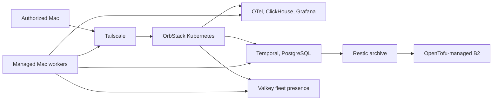

# Operate the private Mac fleet through Kubernetes, Tailscale, and Temporal

Build one private, remotely observable control plane for telemetry and typed, durable operations across trusted Macs.

## Contents

- [1. Outcome](#1-outcome)
- [2. Architecture](#2-architecture)
- [3. Safety boundaries](#3-safety-boundaries)
- [4. Recovery](#4-recovery)
- [5. Delivery contract](#5-delivery-contract)

## 1. Outcome

An operator can use `k9s` and `hnetctl` from any authorized Mac on the tailnet to see the central stack, inspect fleet health, and run narrowly typed workflows.

Success means:

- Kubernetes is the central operational surface.
- Managed Macs remain execution endpoints, not Kubernetes nodes.
- Telemetry collection and break-glass operations keep working during migration.

The operator experience should be concrete:

```text
$ hnetctl fleet status
LABEL       ROLE                 STATE    LAST SEEN
studio      control-plane       ready    8s
laptop      telemetry-worker    ready    11s
```

## 2. Architecture

Tailscale supplies private reachability, Kubernetes runs the central services, and Temporal coordinates durable work without becoming a remote shell.



The central services are divided into `telemetry`, `workflows`, and `platform` namespaces. Valkey stores expiring presence and capacity, never durable workflow or inventory truth.

Relevant platform contracts:

- [Tailscale Kubernetes API access][tailscale-api]
- [Temporal Helm chart][temporal-chart]
- [Valkey Helm chart][valkey-chart]

## 3. Safety boundaries

Access is private by default. The Tailscale Kubernetes Operator exposes only the Kubernetes API and selected browser interfaces to the tailnet; databases and Valkey remain private cluster services.

- No public ingress or Funnel.
- No generic command, script, or arbitrary argument execution in Temporal activities.
- No credentials, tailnet names, private hostnames, IP addresses, or telemetry payloads in Git or workflow history.

Kubernetes secrets come from 1Password references. Standard macOS Remote Login over Tailscale remains the break-glass path.

See the [1Password Kubernetes Operator][onepassword-operator] and [Tailscale Kubernetes ingress][tailscale-ingress].

## 4. Recovery

Temporal coordinates normal archive operations but is not required to restore the control plane. An operator can rebuild the cluster services, retrieve secrets, restore PostgreSQL and ClickHouse data, and reconnect workers using documented `hnetctl` and Kubernetes procedures.

```text
OpenTofu state + repository configuration + 1Password secrets + verified archives
                                  |
                                  v
                   Recovered control plane and telemetry
```

OpenTofu owns durable external infrastructure such as the archive bucket and retention configuration, not in-cluster Helm releases. State must use encryption and contain no resolved credentials.

See [OpenTofu state security][opentofu-state].

## 5. Delivery contract

The epic is delivered through native GitHub sub-issues and dependency relationships. Every child issue must produce an end-to-end, independently verifiable behavior rather than an isolated infrastructure layer.

Issue states use this vocabulary:

| Label | Meaning |
| --- | --- |
| `needs-triage` | Scope and ownership are not yet settled. |
| `needs-info` | A decision or required input is missing. |
| `ready-for-review` | The issue is drafted and awaiting human review. |
| `ready-to-implement` | The issue is approved and independently grabbable. |

The existing Compose deployment remains available until the Kubernetes cutover and rollback drill are complete.

[onepassword-operator]: https://www.1password.dev/k8s/operator
[opentofu-state]: https://opentofu.org/docs/language/state/sensitive-data/
[tailscale-api]: https://tailscale.com/docs/kubernetes-operator/api-server-access
[tailscale-ingress]: https://tailscale.com/docs/kubernetes-operator/ingress
[temporal-chart]: https://github.com/temporalio/helm-charts
[valkey-chart]: https://valkey.io/blog/valkey-helm-chart/
