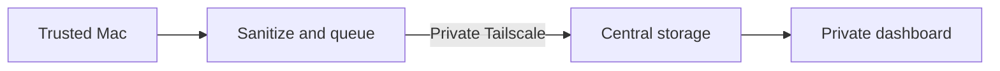
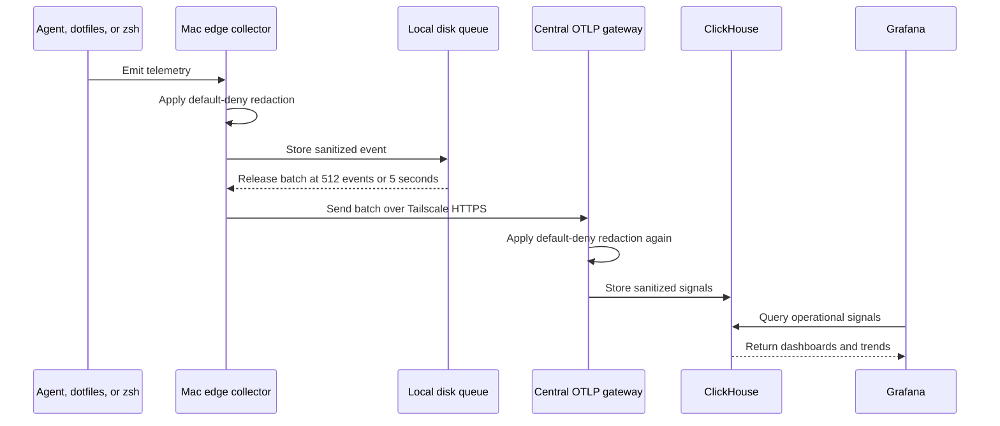

# hnet

Private observability for trusted Macs: understand agent and shell health
without collecting private work.

## Contents

- [What customers see](#what-customers-see)
- [Install on another Mac](#install-on-another-mac)
- [Automatic setup on Macs](#automatic-setup-on-macs)
- [Codex and Grafana](#codex-and-grafana)
- [How it works](#how-it-works)
- [What stays private](#what-stays-private)
- [Access and retention](#access-and-retention)
- [Release previews](#release-previews)

## What customers see

<!-- customer-visible capabilities derived from ops/clients and ops/telemetry -->

hnet makes slow, expensive, and failing work easier to understand. A dashboard
can show which service and model ran, how long it took, whether it succeeded,
and how many tokens it used.

Dashboard counts, trends, and recent activity use the selected time range.

```text
service=agent  model=example  operation=tool-call
duration=2.4s  status=success  tokens_in=820  tokens_out=146
```

Today the product covers agent, shell, and dotfiles setup activity. Browser and
frontend events are not enabled.

## Install on another Mac

<!-- Client distribution, prerequisite installation, and readiness checks from install.sh, ops/apps/hnetctl/client.sh, ops/clients/Brewfile, and ops/clients/files.txt -->

On the working central Mac, build the portable client:

```sh
./ops/apps/hnetctl/hnetctl client-bundle
```

Transfer `dist/hnet-client-macos.tar.gz` and its `.sha256` file to the new Mac.
The bundle includes current unpublished client fixes and excludes private
configuration, credentials, telemetry, and the central services. No Git clone
is needed on the receiving Mac.

From the folder containing the transferred files, run:

```sh
shasum -a 256 -c hnet-client-macos.tar.gz.sha256
tar -xzf hnet-client-macos.tar.gz
cd hnet-client
./install.sh --install-deps
```

The installer checks prerequisites, asks permission to install missing apps
through an existing Homebrew installation, and explains the required app
sign-ins. After completing those sign-ins, rerun `./install.sh`. It prompts
for this Mac's slot, central address, 1Password reference, and optional personal
redaction setting. It installs the client into `~/.local/share/hnet`, starts
the collector, and enrolls the shell and Codex.

In a new terminal:

```sh
hnetctl client-check --connection
codex
```

The checker verifies tools, login/configuration, collector health, and
authenticated connectivity. Complete a Codex turn and confirm the assigned
host and model in Grafana. See the [complete client installation guide](ops/clients/README.md)
for exact prerequisites, enrollment values, failure messages, and repeat setup.

## Release previews

<!-- Versioned release packaging from VERSION, ops/apps/hnetctl/release.sh, ops/clients/release-files.txt, and ops/clients/homebrew-hnet.json -->

Homebrew distribution is being prepared; no published hnet formula exists yet.
Build local versioned macOS previews with:

```sh
./ops/apps/hnetctl/hnetctl --version
./ops/apps/hnetctl/hnetctl release-bundle
```

`dist/hnet-VERSION-darwin-{arm64,amd64}.tar.gz` includes the explicit client and
central support files, MIT license, and checksums. `ops/clients/homebrew-hnet.json`
is an unmanaged tap inventory draft. The preview workflow scans source/history
and saves review artifacts; it does not create tags, publish releases, or update
the tap. See [package lifecycle](ops/clients/README.md#package-lifecycle).

<!-- Local release automation from ops/scripts/release.sh -->

Build, test, scan, verify checksums, and generate preview release notes with:

```sh
./ops/scripts/release.sh
```

To publish an explicitly unsupported GitHub prerelease, the maintainer runs
`./ops/scripts/release.sh --publish`. It requires a clean checkout matching public
GitHub `main`, successful Linux/macOS Actions checks, and an unused version tag.
It uploads the verified archives and checksums without changing the tap or
starting services. Commit and merge script changes before using publish mode.

The first release targets macOS, Codex, Claude Code, a private local/Tailscale
central stack, and optional Synology backups. General ChatGPT conversation
telemetry is unverified; Kubernetes remains experimental. exe.dev is paused.
The strict 24-hour queue age cap remains a release blocker with durable queues
retained. Backup expiry requires explicit maintenance; installing this code does
not change existing retention or start services.

## Automatic setup on Macs

<!-- automatic shell enrollment and startup from ops/apps/hnetctl/hnetctl, ops/clients/zsh/auto.zsh, and ops/telemetry/compose.edge.yml -->

Each additional Mac needs these tools before enrollment:

| Tool | Required setup |
| --- | --- |
| OrbStack or Docker Desktop | Start the local Docker engine; Docker CLI and Compose must be available. |
| Tailscale | Sign into the same trusted tailnet as the central Mac. |
| 1Password for Mac and 1Password CLI (`op`) | Sign in, unlock the app, and enable Settings > Developer > Integrate with 1Password CLI. |
| Codex CLI (`codex`) | Put it on PATH; hnet uses it to validate Codex configuration, including desktop enrollment. |
| hnet client | Use the installer above; it copies the client files into a stable installation location. |

macOS supplies Bash, zsh, curl, Keychain's `security`, `open`, and `pgrep`.
Git is needed if obtaining hnet through Git. Claude Code is needed only on Macs
that will send Claude Code telemetry. Install the ChatGPT/Codex desktop app on
Macs where desktop sessions will be used.

Enroll each Mac once. Its edge collector forwards to the central Mac; every
new interactive zsh session loads the shell client automatically.

1. Configure that Mac's private edge environment and start its collector using
   the [per-Mac setup](ops/telemetry/README.md#automatic-shell-collection).
2. Run these commands from the hnet checkout and approve 1Password when prompted:

   ```bash
   ./ops/apps/hnetctl/hnetctl shell-enable
   ./ops/apps/hnetctl/hnetctl shell-status
   ```

3. Enable **Start at login** in OrbStack (or Docker Desktop), and keep Tailscale
   connected. Existing containers use `unless-stopped`, so they resume with
   Docker unless deliberately stopped.
4. Open a new terminal, run `git status` in the checkout, then refresh Grafana
   after about 15 seconds. Look for service `hnet.zsh` and the Mac's host label.

`shell-enable` imports only the configured Mac's ingestion token into its local
login Keychain. Startup reads Keychain rather than calling 1Password in every
terminal. The token is passed through stdin during import and is never written
into the startup file. Run `shell-enable` again after rotating that Mac's token.

Each Mac has a distinct token and gateway slot, which assigns its host label.
Keychain handles local credentials; central storage provides cross-computer
history. This setup enables shell collection. Enable Codex separately below.

See [verification, rotation, and removal](ops/telemetry/README.md#automatic-shell-collection).

## Codex and Grafana

<!-- Agent enrollment and launchers from ops/apps/hnetctl/hnetctl, ops/clients/codex/config.toml, ops/clients/zsh/codex.zsh, ops/clients/zsh/claude.zsh, and dashboard panels from ops/telemetry/grafana/dashboards/agent-telemetry.json -->

After shell enrollment, configure Codex once on each Mac:

```bash
./ops/apps/hnetctl/hnetctl codex-enable
```

Open a new terminal. Run `codex` for the CLI, `codex-app` for Codex desktop, or
`chatgpt-app` for ChatGPT desktop's integrated Codex. Quit an existing desktop
process before using its launcher. Use the launcher for subsequent desktop
starts too; it stops with a message if the app is already running. These
launchers read the
Mac's ingestion token from Keychain and pass authentication only to their child
processes. Codex configuration contains loopback endpoints and content-logging
controls; it contains no ingestion token.

For Claude Code, run `claude` from a new terminal after shell enrollment. Its
launcher enables native OTLP logs and metrics with content export disabled;
it uses the same local Keychain item without changing Claude settings files.
Direct commands are also available through `hnetctl codex` and `hnetctl claude`.

Open [Agent usage and sessions](http://localhost:2021/d/agent-telemetry) on the
central Mac. Sign in with the Grafana credentials in 1Password, select **Last 15
minutes**, and refresh after a Codex session starts. Check **Recent sessions**,
**Model calls**, **Recent agent tool activity**, and **Hosts and last seen**.
After a completed model response, check **Usage by model**, **Input tokens**,
**Output tokens**, **Cached input tokens**, and **Recent model usage**. These
panels use response events, excluding repeated metric snapshots. Cached input
is part of input; reasoning is part of output. Empty usage panels mean no usage
event was received in the selected period.

Regular ChatGPT web and desktop conversations have no verified per-model OTLP
export in this setup. The ChatGPT launcher covers its integrated Codex runtime;
it does not establish tracking for all ChatGPT conversations.

See [Codex setup and verification](ops/telemetry/README.md#codex) for privacy
settings, desktop restart requirements, and removal. See [Claude Code](ops/telemetry/README.md#claude-code)
for its launch and verification steps.

## How it works

<!-- service flow derived from ops/docs/PROJECT.md and ops/telemetry/README.md -->

Each Mac removes sensitive fields before locally buffering and batching events
to the private central dashboard. Queued events can be retried after a brief
central outage.



See the [service flow](./ops/docs/PROJECT.md) and [telemetry operations](./ops/telemetry/README.md).

The data path is explicit:

<!-- customer-facing telemetry sequence derived from ops/telemetry/collector/edge.yaml and gateway.yaml -->



## What stays private

<!-- privacy guarantees derived from ops/telemetry/collector/edge.yaml and gateway.yaml -->

hnet keeps useful operational metadata. Private access and authentication are
the primary boundary; masking sensitive values is an additional safeguard.

| Source | Stored signal |
| --- | --- |
| Shell | Command category, duration, exit code, safe project label, host identity, timestamp |
| Dotfiles | Setup event name, package name, package manager, tool name, tool version, duration, status, success flag, host identity, timestamp |
| Agents | Service, model, operation, token counts, session ID, status, safe tool name, duration, app version, host identity, timestamp |

Collection scope is unchanged: attribute allowlists still apply, and log bodies
and span status messages are emptied.
Model names, scope metadata, metric names/units/descriptions, links, and exemplars
are retained.

Both collectors mask recognized credential assignments, bearer tokens,
13-19 digit card-like values (including spaces or hyphens), and configured
personal matches in retained attributes. Numeric attribute values are checked
too. Configure your email, address, and other known values privately as described
in [Telemetry](ops/telemetry/README.md#personal-matches).

This is pattern matching, not a guarantee of detecting every secret. Scalar
metadata (such as names and descriptions), span links, and metric exemplars are
not scanned. Unknown credentials and unlisted personal information can remain;
long numeric identifiers can match the card pattern. Transform errors drop the
affected payload. The gateway assigns host labels from each authenticated Mac's
receiver.

## Access and retention

<!-- access and retention boundaries derived from ops/telemetry/README.md and compose files -->

Dashboards and ingestion stay private behind Tailscale; there is no public
internet endpoint. Live telemetry is retained for 14 days. Optional Restic
archives provide encrypted NAS or cloud backups with separate retention.

Credentials, private host details, and raw telemetry do not belong in this
repository.
