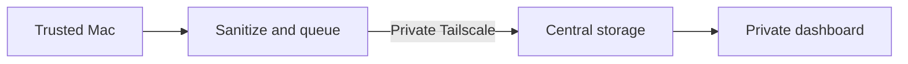
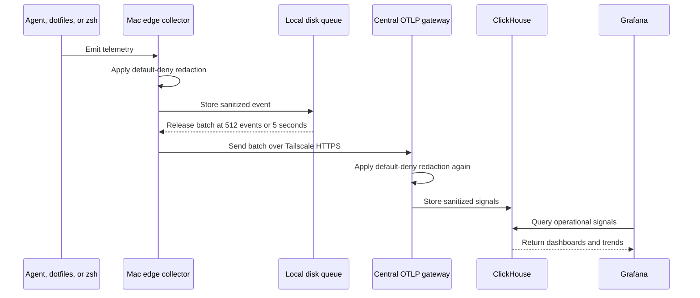

# hnet

Private observability for trusted Macs: understand agent and shell health
without collecting private work.

## Contents

- [What customers see](#what-customers-see)
- [How it works](#how-it-works)
- [What stays private](#what-stays-private)
- [Access and retention](#access-and-retention)

## What customers see

<!-- customer-visible capabilities derived from ops/clients and ops/telemetry -->

hnet makes slow, expensive, and failing work easier to understand. A dashboard
can show which service and model ran, how long it took, whether it succeeded,
and how many tokens it used.

Dashboard counts, trends, and recent activity use the selected time range.

```text
service=agent  model=example  operation=tool-call
duration=2.4s  status=success  tokens_in=820  tokens_out=146
```

Today the product covers agent, shell, and dotfiles setup activity. Browser and
frontend events are not enabled.

## How it works

<!-- service flow derived from ops/docs/PROJECT.md and ops/telemetry/README.md -->

Each Mac removes sensitive fields before locally buffering and batching events
to the private central dashboard. Queued events can be retried after a brief
central outage.



See the [service flow](./ops/docs/PROJECT.md) and [telemetry operations](./ops/telemetry/README.md).

The data path is explicit:

<!-- customer-facing telemetry sequence derived from ops/telemetry/collector/edge.yaml and gateway.yaml -->



## What stays private

<!-- privacy guarantees derived from ops/telemetry/collector/edge.yaml and gateway.yaml -->

hnet keeps useful operational metadata. Private access and authentication are
the primary boundary; masking sensitive values is an additional safeguard.

| Source | Stored signal |
| --- | --- |
| Shell | Command category, duration, exit code, safe project label, host identity, timestamp |
| Dotfiles | Setup event name, package name, package manager, tool name, tool version, duration, status, success flag, host identity, timestamp |
| Agents | Service, model, operation, token counts, session ID, status, safe tool name, duration, app version, host identity, timestamp |

Collection scope is unchanged: attribute allowlists still apply, and log bodies
and span status messages are emptied.
Model names, scope metadata, metric names/units/descriptions, links, and exemplars
are retained.

Both collectors mask recognized credential assignments, bearer tokens,
13-19 digit card-like values (including spaces or hyphens), and configured
personal matches in retained attributes. Numeric attribute values are checked
too. Configure your email, address, and other known values privately as described
in [Telemetry](ops/telemetry/README.md#personal-matches).

This is pattern matching, not a guarantee of detecting every secret. Scalar
metadata (such as names and descriptions), span links, and metric exemplars are
not scanned. Unknown credentials and unlisted personal information can remain;
long numeric identifiers can match the card pattern. Transform errors drop the
affected payload. The gateway assigns host labels from each authenticated Mac's
receiver.

## Access and retention

<!-- access and retention boundaries derived from ops/telemetry/README.md and compose files -->

Dashboards and ingestion stay private behind Tailscale; there is no public
internet endpoint. Live telemetry is retained for 14 days. Optional Restic
archives provide encrypted NAS or cloud backups with separate retention.

Credentials, private host details, and raw telemetry do not belong in this
repository.
