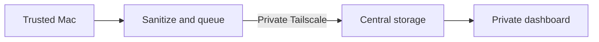
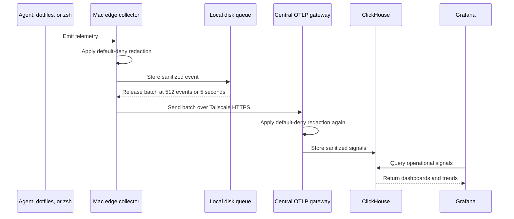
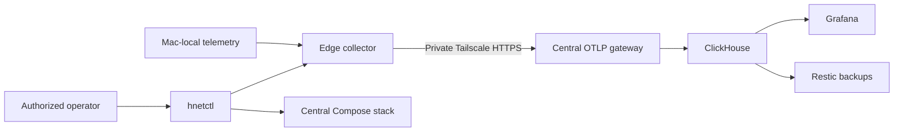

# hnet

Private observability for Codex, Claude Code, and shell activity across trusted
Macs. View token usage, models, sessions, errors, and duration in Grafana.

## Homelab roles

<!-- Central and edge roles from ops/apps/hnetctl/hnetctl and ops/telemetry/compose.mac-studio.yml -->

Choose one always-on Mac as the **central host** before adding other computers.

| Role | Runs |
| --- | --- |
| Central host | Telemetry gateway, ClickHouse storage, and Grafana dashboards |
| Edge clients | Local collectors that send each Mac's telemetry to the central host |
| Synology | Optional encrypted backups |

In Kubernetes, the **[control plane](https://kubernetes.io/docs/concepts/overview/components/)**
manages a cluster and **worker nodes** run workloads. hnet's central host and edge
clients describe telemetry roles; enrolling a Mac does not join a Kubernetes cluster.

## Set up the central host

<!-- Packaged central setup from ops/clients/launcher.sh, ops/telemetry/.env.mac-studio.example, and ops/apps/hnetctl/hnetctl -->

1. Install [Homebrew](https://brew.sh), then run on the main Mac:

   ```sh
   brew install yowainwright/tap/hnet
   brew install --cask tailscale-app 1password 1password-cli
   ```

   Install OrbStack with `brew install --cask orbstack` if you do not already
   use Docker Desktop. Start Docker and enable **Start at login**. Sign into
   Tailscale and unlock 1Password; enable its **Settings > Developer > Integrate
   with 1Password CLI** option.

2. Create an `agent-telemetry` item in your chosen 1Password vault:

   | Field | Requirement |
   | --- | --- |
   | `grafana-admin-password` | Generated password, at least 24 characters |
   | `clickhouse-writer-password` | Different generated password, at least 24 characters |
   | `clickhouse-reader-password` | Different generated password, at least 24 characters |
   | `mac-studio-token` | Unique random token for the central Mac |
   | `mac-mini-1-token` | Unique random token for the first edge Mac |
   | `mac-mini-2-token` | Unique random token for the second edge Mac |

   Each token needs at least 32 characters using letters, digits, `.`, `_`, `~`,
   or `-`. Generated 64-character hexadecimal tokens meet that requirement.

3. Create the private configuration outside Homebrew:

   ```sh
   umask 077
   state="${HNET_CLIENT_HOME:-$HOME/.local/share/hnet}/ops/telemetry"
   install -d -m 700 "$state"
   test -e "$state/.env.mac-studio" || cp \
     "$(brew --prefix hnet)/share/hnet/ops/telemetry/.env.mac-studio.example" \
     "$state/.env.mac-studio"
   chmod 600 "$state/.env.mac-studio"
   open -e "$state/.env.mac-studio"
   ```

   Set `TAILSCALE_DNS_NAME` to this Mac's full `.ts.net` name from Tailscale,
   without `https://` or a port. Replace `YOUR_VAULT` in every `op://` reference.
   Keep the default ports. Save and close the file; keep secret values in 1Password.

4. Start the services, then configure private Tailscale HTTPS access:

   ```sh
   hnetctl start
   hnetctl serve
   hnetctl status
   ```

   Approve 1Password when prompted. First startup downloads images and can take
   several minutes. `serve` configures ports `443`, `4318`, `4319`, and `4320`;
   review existing Tailscale Serve mappings first and complete any requested
   HTTPS setup. Do not enable Funnel or router port forwarding.

5. Open `http://localhost:2021/d/agent-telemetry`. Sign in as `admin` with the
   Grafana password from 1Password. Other Macs use
   `https://YOUR-CENTRAL-DNS-NAME/d/agent-telemetry`. The dashboard stays empty
   until an enrolled client sends events. To collect this Mac's own shell and
   agent telemetry too, run `hnetctl client-install --install-deps` after central
   startup. Use the `mac-studio` slot, its token reference, and this Mac's own
   Tailscale URL on port `4318`. The packaged installer preserves central
   configuration and backups. Then verify from a new terminal with
   `hnetctl client-check --connection`.

## Add another Mac to the homelab

<!-- Installation and enrollment from ops/apps/hnetctl/client.sh and ops/clients/Brewfile -->

Requires Homebrew, OrbStack or Docker Desktop, Tailscale, 1Password with CLI
integration enabled, and Codex CLI. The installer can install missing tools:

```sh
brew install yowainwright/tap/hnet
hnetctl client-install --install-deps
```

Complete the requested app sign-ins, unlock 1Password, and rerun
`hnetctl client-install`. Connect Tailscale to the central host's tailnet.

For example, enroll the first additional Mac using the existing `mac-mini-1` slot:

| Installer prompt | Example value |
| --- | --- |
| Mac label | `mac-mini-1` |
| Central HTTPS URL | `https://central.YOUR-TAILNET.ts.net:4319` |
| Token reference | `op://YOUR_VAULT/agent-telemetry/mac-mini-1-token` |

Replace the example hostname and vault with your central host's actual settings.
On the central host, find the address and token references in its private
configuration. Enter the reference, never the resolved token.

Use an unused slot and a separate token for every Mac. The second additional Mac
uses `mac-mini-2`, port `4320`, and its corresponding token. More slots require
central configuration first; the slot labels do not need to match Mac hardware.

Setup starts the collector and enables shell and Codex telemetry. Open a new
terminal to verify:

```sh
hnetctl client-check --connection
```

Enable **Start at login** in your Docker app and keep Tailscale connected.

Complete a Codex reply and confirm the new Mac's label and usage in Grafana.
Private enrollment lives under `~/.local/share/hnet/ops/telemetry/.env.edge`.
To enroll without prompts, put the settings in a private file and pass
`hnetctl client-install --config /path/to/private-enrollment.env`.

## Use agents and view usage

<!-- Agent launchers and dashboards from ops/clients/zsh and ops/telemetry/grafana/dashboards/agent-telemetry.json -->

After enrollment, use a new terminal:

| Agent | Command |
| --- | --- |
| Codex CLI | `codex` |
| Codex desktop | `codex-app` |
| Claude Code | `claude` |

Install Claude Code separately if needed. Fully quit desktop apps before starting
them through the launcher; use the launcher for subsequent starts.

Complete a reply, then open [Agent usage and sessions](http://localhost:2021/d/agent-telemetry)
on the central Mac. Sign in with the Grafana credentials in 1Password, select
**Last 15 minutes**, and refresh. On other Macs, use the central Mac's Tailscale
dashboard address.

Regular ChatGPT conversations are not tracked. `chatgpt-app` covers only its
integrated Codex runtime.

Codex enrollment preserves existing settings and refuses conflicting OTel
configuration or symlinked startup files. Claude's launcher supplies telemetry
settings without changing its settings file. Both use the local Keychain token.
Token counts measure usage, not subscription charges. Cached input is part of
input; reasoning is part of output. Do not add those subsets to totals again.

## How it works

<!-- Service flow from ops/apps/hnetctl/hnetctl and ops/telemetry/compose.mac-studio.yml -->



<!-- customer-facing telemetry sequence derived from ops/telemetry/collector/edge.yaml and gateway.yaml -->





## Data and privacy

<!-- Privacy and retention from ops/telemetry/collector, ops/telemetry/retention.sh, and ops/telemetry/.env.mac-studio.example -->

Each Mac filters and buffers telemetry, then sends it privately over Tailscale.
ClickHouse stores it; Grafana displays it.

hnet keeps operational metadata. Allowlists exclude prompts, completions, and raw
shell commands; log bodies and span status messages are emptied. Shell events
keep command category, duration, exit code, and a safe project label. Agent
events keep model, usage, session, status, and safe tool metadata.

Redaction masks recognized credential assignments, bearer tokens, card-like
numbers, and configured personal matches in retained attributes. It cannot
detect every secret. Metadata names/descriptions, span links, and metric
exemplars are retained without scanning. Keep access private.

### Personal redaction

Set `AGENT_TELEMETRY_REDACT_PATTERN` in each private central/edge config, using
the same setting on every collector. The default `a^` adds no personal matches.
Use literal values separated by `|`, or a 1Password reference:

```dotenv
AGENT_TELEMETRY_REDACT_PATTERN=\Qperson@example.invalid\E|\Q123 Example Street\E
```

Matching is case-sensitive; prefix with `(?i)` for case-insensitive matching.
Arbitrary regex syntax is rejected. After changing the setting, run `hnetctl
start` centrally and `hnetctl edge-start` on affected clients; `restart` does
not refresh container environments.

Live telemetry has a 14-day retention policy. Buffered telemetry has no enforced
24-hour expiry. Optional encrypted Synology backups have separate retention and
require explicit expiry maintenance.

Each Mac's token is stored in login Keychain. Programs running as your user can
access it; locking 1Password does not revoke an enrolled token.

## Checks, upgrades, and removal

<!-- Lifecycle and diagnostics from ops/apps/hnetctl/client.sh, ops/apps/hnetctl/hnetctl, and ops/clients/zsh/auto.zsh -->

| Check | Command |
| --- | --- |
| Client prerequisites | `hnetctl client-check --prerequisites` |
| Enrollment and connectivity | `hnetctl client-check --connection` |
| Edge collector | `hnetctl edge-status` or `hnetctl edge-logs` |
| Central services | `hnetctl status` |
| Central logs | `hnetctl logs clickhouse`, `collector`, or `grafana` |

Connection checks send empty probes; a completed agent reply visible in Grafana
proves usage delivery. If no data arrives, check Docker, Tailscale, slot/port
pairing, Keychain access, and Grafana's time range. Unlock Keychain and open a
new terminal if startup skipped collection. Keep logs private.

Upgrade with `brew update` and `brew upgrade hnet`. Open new terminals and
fully relaunch desktop agents. Running collectors keep their mounted
configuration until explicitly recreated; review release notes before rollout.

For token rotation, update the matching central and edge credentials, run
`hnetctl start` centrally and `hnetctl edge-start` on that client, then
`hnetctl shell-enable`. Open new terminals, relaunch agents, and verify the old
token is rejected. Existing processes retain previously loaded credentials.

`brew uninstall hnet` preserves private settings, queues, backups, and Keychain
credentials. When retiring a Mac, revoke its token centrally and stop its
collector. Remove the marked hnet blocks from zsh startup and Codex config if
removing those integrations. Keychain removal and private-data deletion are
separate actions; do not delete volumes to troubleshoot.

## Synology backups

<!-- Backup and retention commands from ops/apps/hnetctl/hnetctl and ops/telemetry/.env.restic.nas.example -->

On the central Mac, install Restic and create a private backup profile:

```sh
brew install restic
state="${HNET_CLIENT_HOME:-$HOME/.local/share/hnet}/ops/telemetry"
test -e "$state/.env.restic.nas" || cp \
  "$(brew --prefix hnet)/share/hnet/ops/telemetry/.env.restic.nas.example" \
  "$state/.env.restic.nas"
chmod 600 "$state/.env.restic.nas"
open -e "$state/.env.restic.nas"
```

Set `RESTIC_REPOSITORY` to the Synology SFTP destination and `RESTIC_PASSWORD`
to its 1Password reference. Configure SSH access to that destination. Keep the
encryption password available for recovery independently of the central Mac.

```sh
hnetctl restic-init nas   # Once, for a new repository
hnetctl archive nas      # Create and encrypt a database backup
hnetctl retention nas    # Preview expired snapshots; deletes nothing
```

`BACKUP_RETENTION_DAYS` defaults to 30. After testing a restore and reviewing
the preview, `hnetctl retention nas --apply` deletes selected snapshots and
prunes unused data. No schedule is installed. Local backup staging remains;
snapshot age does not bound the age of telemetry inside it.

## Archive installs and source use

<!-- Portable installation and source operations from install.sh and ops/apps/hnetctl/hnetctl -->

To transfer an unpublished client from a checkout, run
`./ops/apps/hnetctl/hnetctl client-bundle`. Transfer the archive and checksum
from `dist/` to the new Mac, then:

```sh
shasum -a 256 -c hnet-client-macos.tar.gz.sha256
tar -xzf hnet-client-macos.tar.gz
cd hnet-client
./install.sh --install-deps
```

Complete sign-ins and rerun `./install.sh`. It performs the same enrollment as
Homebrew. `--prefix /absolute/directory` selects a custom location. Repeating
enrollment preserves existing settings; unmanaged files or conflicting
configuration stop setup rather than being overwritten.

From a checkout, use `./ops/apps/hnetctl/hnetctl` instead of the packaged
`hnetctl`. Private central and edge configs live in `ops/telemetry/`; copy the
corresponding `.env.*.example` first. For manual collection on the central Mac,
configure `.env.edge` with its `mac-studio` slot, then run `edge-start`,
`shell-enable`, and `codex-enable`. The checkout must remain available.

Kubernetes support is experimental and requires a checkout. The chart is in
`ops/telemetry/`; use `cluster-lint`, `cluster-template`,
`cluster-secrets`, `cluster-install`, and `cluster-status` through hnetctl.
Set `HNET_KUBE_SECRET` consistently when choosing a custom Secret name.
Services remain private; client enrollment does not add Kubernetes worker nodes.
exe.dev deployment is paused.

## Development and releases

<!-- Release tasks from mise.toml and ops/scripts/release.sh -->

From a checkout with Mise configured:

```sh
mise run check
mise run release-preview
mise run release:patch:dry-run
mise run release:patch
```

Use `release:minor` or `release:major` for larger bumps; each has a
`:dry-run` task. Bumps use the latest stable tag and skip release candidates.
`mise run release` keeps the interactive picker; pass `-- vX.Y.Z` for an exact version.

Release from clean `main` matching `origin/main`, after Linux and macOS CI pass.
The release command selects a version, confirms, tags, and starts signed GitHub
publication. Stable releases update the Homebrew tap automatically and require
`HOMEBREW_TAP_TOKEN`; release candidates skip the tap.

For full operations validation, run `tests/ops/apps/hnetctl/hnetctl_test.sh`
and `./ops/scripts/validate.sh`. Collector validation uses disposable,
network-disabled containers. Keep credentials, private host details, telemetry,
queues, and backups out of Git.
