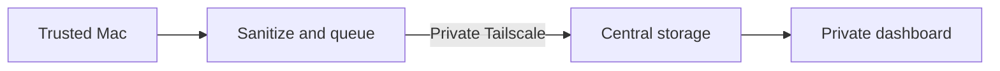

# hnet

Private observability for trusted Macs: understand agent and shell health
without collecting private work.

## Contents

- [What customers see](#what-customers-see)
- [How it works](#how-it-works)
- [What stays private](#what-stays-private)
- [Access and retention](#access-and-retention)

## What customers see

<!-- customer-visible capabilities derived from ops/clients and ops/telemetry -->

hnet makes slow, expensive, and failing work easier to understand. A dashboard
can show which service and model ran, how long it took, whether it succeeded,
and how many tokens it used.

```text
service=agent  model=example  operation=tool-call
duration=2.4s  status=success  tokens_in=820  tokens_out=146
```

Today the product covers agent and shell activity. Browser and frontend events
are not enabled.

## How it works

<!-- service flow derived from ops/docs/PROJECT.md and ops/telemetry/README.md -->

Each Mac removes sensitive fields before locally buffering and batching events
to the private central dashboard. Queued events can be retried after a brief
central outage.



See the [service flow](./ops/docs/PROJECT.md) and [telemetry operations](./ops/telemetry/README.md).

## What stays private

<!-- privacy guarantees derived from ops/telemetry/REDACTION.md -->

Telemetry is default-deny. hnet never stores command contents, terminal output,
prompts, completions, tool contents, environment variables, paths, account
identifiers, or request and response bodies.

The retained signal is limited to operational facts: service, model, operation,
duration, status, token counts, versions, host, and an optional safe project
label. See the [redaction contract](./ops/telemetry/REDACTION.md).

## Access and retention

<!-- access and retention boundaries derived from ops/telemetry/README.md and compose files -->

Dashboards and ingestion stay private behind Tailscale; there is no public
internet endpoint. Live telemetry is retained for 14 days. Optional Restic
archives provide encrypted NAS or cloud backups with separate retention.

Credentials, private host details, and raw telemetry do not belong in this
repository.
